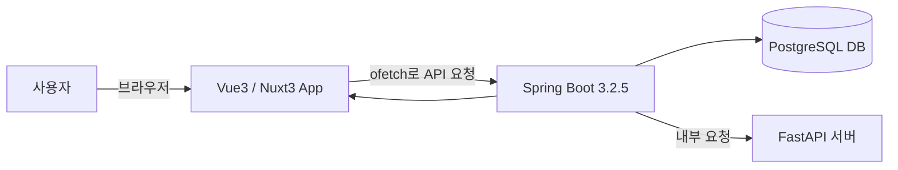

# 📘 프로젝트 프로세스 명세서 (템플릿)

## 🧾 문서 개요

- **프로젝트명:** (예: 데이터 관리 포털)
- **작성일:** 2025-03-26
- **작성자:** 홍길동
- **기술 스택:**
  - Frontend: Vue 3, Nuxt 3
  - Backend: Spring Boot 3.2.5
  - Database: PostgreSQL
  - API 통신: REST (ofetch)
  - 인증 방식: JWT (Access + Refresh Token)

---

## 🏗 시스템 아키텍처 개요

---

## 🔄 주요 프로세스 정의

### ✅ [프로세스 이름: 사용자 로그인]

| 항목     | 내용                                         |
| ------ | ------------------------------------------ |
| 프로세스명  | 사용자 로그인                                    |
| 관련 페이지 | `/login`                                   |
| 개요     | 사용자 인증 정보를 받아 로그인 처리 및 토큰 발급               |
| 프론트 동작 | 로그인 폼 입력 후 `POST /api/auth/login` 요청       |
| 백엔드 동작 | 사용자 검증 → JWT 생성 → 응답                       |
| 응답     | `200 OK` + `access_token`, `refresh_token` |
| 실패 응답  | `401 Unauthorized`, `403 Forbidden` 등      |

---

### ✅ [프로세스 이름: 게시글 목록 조회]

| 항목     | 내용                                         |
| ------ | ------------------------------------------ |
| 프로세스명  | 게시글 목록 조회                                  |
| 관련 페이지 | `/posts`                                   |
| 개요     | 게시글 목록을 조회하여 화면에 출력                        |
| 프론트 동작 | `useFetch('/api/posts')` 또는 `asyncData` 사용 |
| 백엔드 동작 | 게시글 목록 DB 조회 + 페이징 처리                      |
| 응답     | 게시글 배열(JSON), 페이징 정보 포함                    |
| 실패 응답  | `500 Internal Server Error` 등              |

---

## 🔌 API 요약 목록

| API 경로             | 메서드  | 설명        |
| ------------------ | ---- | --------- |
| `/api/auth/login`  | POST | 사용자 로그인   |
| `/api/auth/signup` | POST | 회원가입      |
| `/api/posts`       | GET  | 게시글 목록 조회 |
| `/api/posts/{id}`  | GET  | 게시글 상세 조회 |
| `/api/posts`       | POST | 게시글 등록    |

> 자세한 스펙은 Swagger 또는 OpenAPI 명세 참고

---

## 🔐 인증 처리 흐름

- 로그인 성공 시 Access Token + Refresh Token 발급
- 토큰은 Cookie에 저장 (HttpOnly 권장)
- 모든 API 요청 시 Access Token 자동 포함
- 토큰 만료 시 Refresh Token으로 재발급 처리

---

## 🧩 기타 참고 사항

- Vue3 + Nuxt3: `useFetch`, `defineNuxtRouteMiddleware`, `useAsyncData` 활용
- Spring Boot: `@RestController`, `@RequestMapping`, `@ExceptionHandler` 구조
- 공통 응답 구조: `code`, `message`, `data` 필드로 구성된 JSON

---

> 📎 이 템플릿을 복사해 각 기능/페이지별 명세로 확장해 나가세요.

