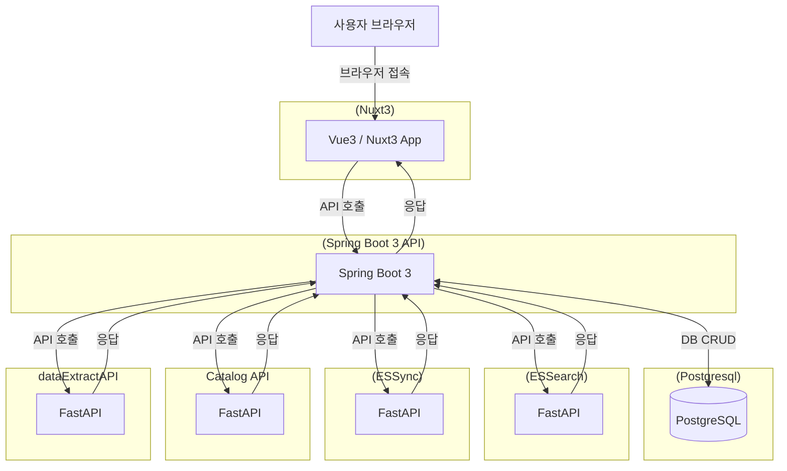

# 📘 프로젝트 프로세스 명세서

## 🧾 문서 개요

- **프로젝트명:** 데이터 카탈로그 포털
- **작성일:** 2025-03-26
- **작성자:** 성치훈
- **기술 스택:**
  - Frontend: Vue 3.4.21, Nuxt 3.11.2
  - Backend: Spring Boot 3
  - Database: PostgreSQL 14.12
  - API 통신: REST (ofetch)
  - 인증 방식: JWT (Access + Refresh Token)

---

## 🏗 시스템 아키텍처 개요



---

## 🔄 주요 프로세스 정의
- 기본 페이지의 경로 : ../source/frontend/nuxt-project/pages

### ✅ [프로세스 이름: 로그인]

| 항목     | 내용                                         |
| ------ | ------------------------------------------ |
| 프로세스명  | 사용자 로그인 |
| 관련 페이지 | `/index.vue` |
| 개요     | 사용자 id, password를 받아 로그인 처리 및 토큰 발급 |
| 프론트 동작 | 로그인 폼 입력 후 `POST /api/authenticate` 요청 |
| 백엔드 동작 | 사용자 검증 → JWT 생성 → 응답 |
| 응답     | `access_token`, `refresh_token` |
| 실패 응답  | `실패 결과 반환` |

---

### 로그인 처리 흐름

- 로그인 성공 시 Access Token + Refresh Token 발급, 사용자 정보 업데이트(로그인 시각, 로그인 실패횟수 초기화)
- 모든 API 요청 및 라우팅 시 Access Token 확인
- 토큰 만료 시 Refresh Token으로 재발급 처리
- Refresh Token도 만료 시 로그인 만료 처리

---

### ✅ [프로세스 이름: 통합검색]

| 항목     | 내용                                         |
| ------ | ------------------------------------------ |
| 프로세스명  | 데이터 검색 > 통합검색                                  |
| 관련 페이지 | `/search/keyowrd/index.vue`                                   |
| 개요     | Elasticsearch 검색을 통해 메타데이터 목록 조회                        |
| 프론트 동작 | 검색어 및 조건 입력 or 선택 후 사용자 권한ID를 담아 `POST /api/search/getEsSearch` 요청 |
| 백엔드 동작 | ESSearch FastAPI 서버에 검색 요청 → 응답                      |
| 응답     | 검색결과 배열(JSON)                    |
| 실패 응답  | `실패 결과 반환`              |

---

### 통합검색 흐름

- 검색 파라미터를 담아 서버에 검색 요청
```json
{
    "query": "", // 검색어
    "system_type": "Postgres", // DB 종류
    "meta_type": "table", // 메타 종류
    "tag": "", // 태그
    "limit": 10, // 조회 개수
    "offset": 0, // 조회 시작 위치
    "classification": "MG", // 카테고리
    "sortBy": "create_time", // 수집일 기준 정렬
    "sortOrder": "ASC", // 오름차순/내림차순
    "entityFilters": { // 추가속성필터
        "condition": "AND", // 그룹 조건
        "criterion": [
            {
                "idx": 0,
                "attributeName": "db_schema", // 추가속성필터 필드명
                "typeName": "string", // 추가속성필터 타입
                "operator": "=", // 추가속성필터 조건
                "attributeValue": "public", // 추가속성필터 값
                "attributeValueText": "public＂ // 날짜 타입인 경우 사용하는 날짜 TEXT값
            }
        ]
    }
}
```
- 서버에서 사용자에 대한 데이터 권한 확인
- 사용자가 부여된 role_id를 배열에 담아 검색 파라미터에 추가
- Elasticsearch 작업 서버의 검색 API 호출
- 검색결과 반환

---

### 🧩 통합검색 참고 사항

- 추가속성필터에서 UI에서 보이는 필드명과 실제 Elasticsearch로 요청 시 전달하는 필드명이 다른 필드가 존재
> meta_name => meta_name.keyword\
> table_type => attributes.table_type\
> description => description.keyword\
> user_description => user_description.keyword\
> column_name => attributes.columns.meta_name.keyword\
> column_description => attributes.columns.description.keyword\
> classifications => classifications.c_description.keyword

---

### ✅ [프로세스 이름: 데이터 요청]

| 항목     | 내용                                         |
| ------ | ------------------------------------------ |
| 프로세스명  | 고객 지원 > 데이터 요청                                  |
| 관련 페이지 | `/data/request/register/index.vue`                                   |
| 개요     | 데이터 요청 입력 후 등록                  |
| 프론트 동작 | 데이터 요청 폼 입력 후 `POST /api/dataRequest/add/saveFile` 요청 |
| 백엔드 동작 | 데이터 요청 등록 처리 → 이메일 발송 → 응답                      |
| 응답     | 성공 결과 반환(JSON)                    |
| 실패 응답  | `실패 결과 반환`              |

---

### 데이터 요청 흐름

- 데이터 요청 내용을 파라미터에 담아 서버에 등록 요청
- JWT 토큰에 있는 사용자 ID를 작성자 id로 설정하여 파라미터에 추가
- 
- 첨부파일이 있는 경우 파일업로드 처리
- 데이터 요청 등록 처리
- 데이터 요청 등록에 성공하면 이메일 발송
- 등록 결과 반환

---

### 🧩 데이터 요청 참고 사항

- properties.activeSendMail.data-request 이메일 발송 기능이 true인 경우 이메일 발송

---

### ✅ [프로세스 이름: 데이터 요청 답변]

| 항목     | 내용                                         |
| ------ | ------------------------------------------ |
| 프로세스명  | 고객 지원 관리 > 데이터 요청 답변                               |
| 관련 페이지 | `/admin/manager/user/response/update/index.vue`                                   |
| 개요     | 데이터 요청 답변 등록                        |
| 프론트 동작 | 데이터 요청 답변 입력 후 `POST /api/dataRequest/updateAdminReply` 요청 |
| 백엔드 동작 | 데이터 요청 답변 처리 → 이메일 발송 → 응답                      |
| 응답     | 성공 결과 반환(JSON)                    |
| 실패 응답  | `실패 결과 반환`             |

---

### 데이터 요청 답변 흐름

- 데이터 요청 답변 내용을 파라미터에 담아 서버에 등록 요청
- JWT 토큰에 있는 사용자 ID를 작성자 id로 설정하여 파라미터에 추가
- 데이터 요청 답변 등록 처리
- 답변 등록 성공 시 이메일 발송
- 답변 등록에 성공하면 이메일 발송
- 등록 결과 반환

---

### 🧩 데이터 요청 답변 참고 사항

- properties.activeSendMail.data-request 이메일 발송 기능이 true인 경우 이메일 발송

---

### ✅ [프로세스 이름: 카테고리 매핑]

| 항목     | 내용                                         |
| ------ | ------------------------------------------ |
| 프로세스명  | 메타 데이터 관리 > 메타 데이터 통합 관리 > 카테고리 매핑                               |
| 관련 페이지 | `/admin/data/meta-data/manage/index.vue`                                   |
| 개요     | 메타 데이터 카테고리 매핑                        |
| 프론트 동작 | 매핑할 데이터 선택 후 `POST /api/dataRequest/updateAdminReply` 요청 |
| 백엔드 동작 | 데이터 요청 답변 처리 → 이메일 발송 → 응답                      |
| 응답     | 성공 결과 반환(JSON)                    |
| 실패 응답  | `실패 결과 반환`             |

---

### 카테고리 매핑 흐름

- 
- JWT 토큰에 있는 사용자 ID를 작성자 id로 설정하여 파라미터에 추가
- 데이터 요청 답변 등록 처리
- 답변 등록 성공 시 이메일 발송
- 답변 등록에 성공하면 이메일 발송
- 등록 결과 반환

---

### 🧩 카테고리 매핑 참고 사항

- properties.activeSendMail.data-request 이메일 발송 기능이 true인 경우 이메일 발송

---

## 🔌 주요 API 요약 목록

| API 경로             | 메서드  | 설명        |
| ------------------ | ---- | --------- |
| `/api/authenticate`  | POST | 사용자 로그인   |
| `/api/search/getEsSearch` | POST | 통합검색      |
| `/api/dataRequest/add/saveFile`       | POST  | 데이터 요청 등록 |
| `/api/posts/{id}`  | GET  | 게시글 상세 조회 |
| `/api/posts`       | POST | 게시글 등록    |

---


## 🧩 기타 참고 사항

- Vue3 + Nuxt3: `ofetch`, `pinia` 활용
- Spring Boot: `@RestController`, `@RequestMapping`, `@ExceptionHandler` 구조
- 공통 응답 구조: `result`, `errorMessage`, `data` 필드로 구성된 JSON

---